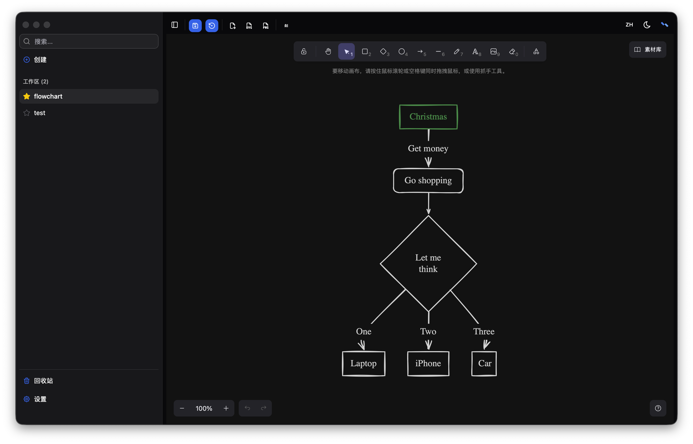

Nexthena v1.2.1 is out, and it's centered around two features: **Internationalization (i18n)** and **System Theme Fixes**.

<!-- truncate -->

## Internationalization (i18n)

Nexthena now supports **English** and **Chinese** out of the box. All UI components use translation keys instead of hardcoded strings, and a language switch in the header lets you toggle locales instantly. Your preference is persisted to the backend and restored on next launch. The Excalidraw whiteboard also follows the app locale — switching to Chinese will automatically apply `zh-CN` to the whiteboard UI.

## System Theme Fixes

When "Follow System" theme mode is selected, the whiteboard and code syntax highlighting now correctly follow the OS dark/light setting. Previously, they would always fall back to light mode because the theme context only exposed `"system"` as a raw value without resolving it. A new `effectiveTheme` field in the theme provider now always resolves to `"dark"` or `"light"`, and all consumers use it directly.
