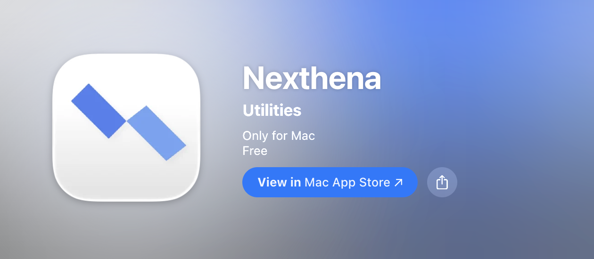

Nexthena is now free on macOS, Windows, and Linux. The macOS version previously cost ¥2; it is now free, just like the Windows and Linux versions.

<!-- truncate -->

## Download Nexthena for Free

- **macOS:** [Download from the Mac App Store](https://apps.apple.com/us/app/nexthena/id6756844674)
- **Windows and Linux:** [Download the latest release from GitHub](https://github.com/blackstar-baba/nexthena-asset/releases/tag/v1.3.3)

Nexthena is free on every platform. If you connect a third-party AI provider, its own usage terms and fees may still apply.

For setup instructions, see the [getting started guide](/docs/intro).
