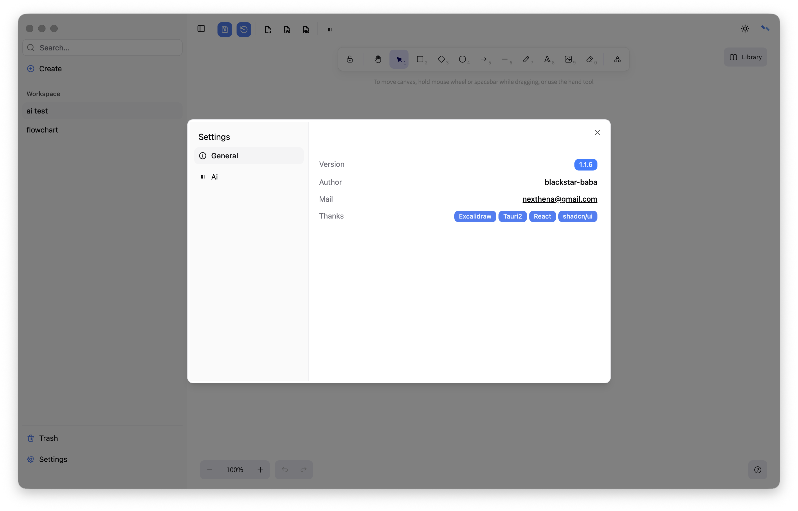
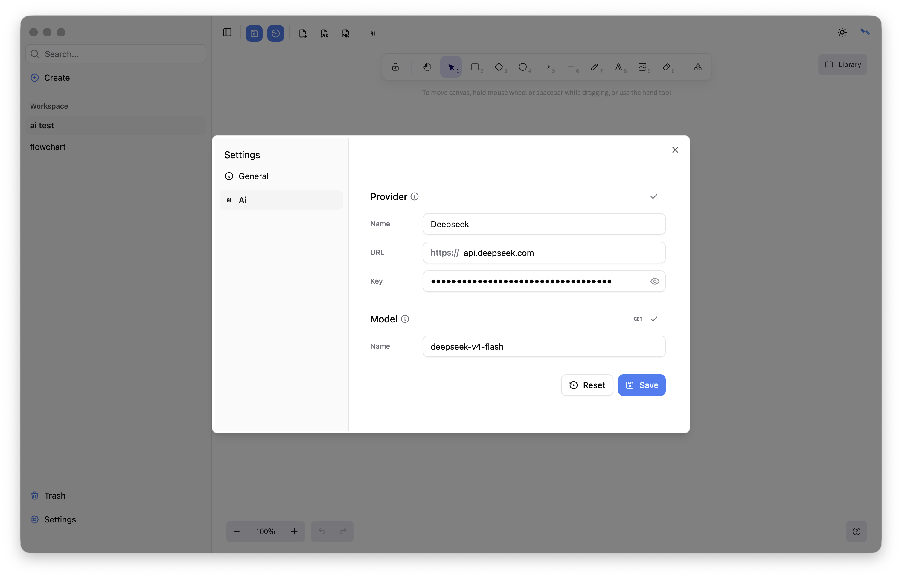

# Settings

## General
Basic app information.

## Ai
Configure the provider and model information. They will be used when generating whiteboard elements with AI.
**Notice:provider only support OpenAI api.**

