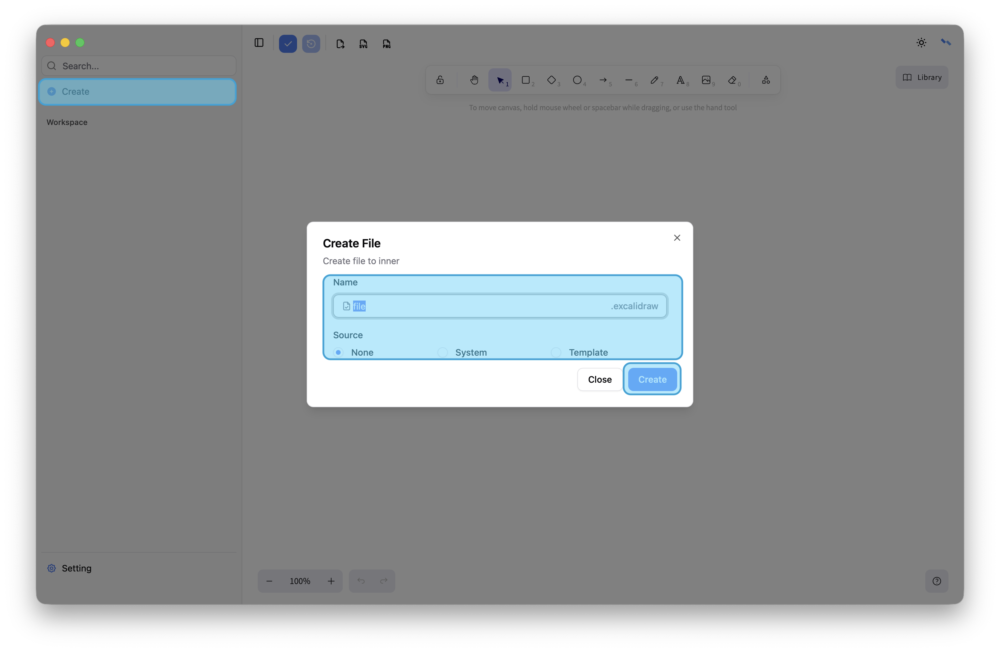
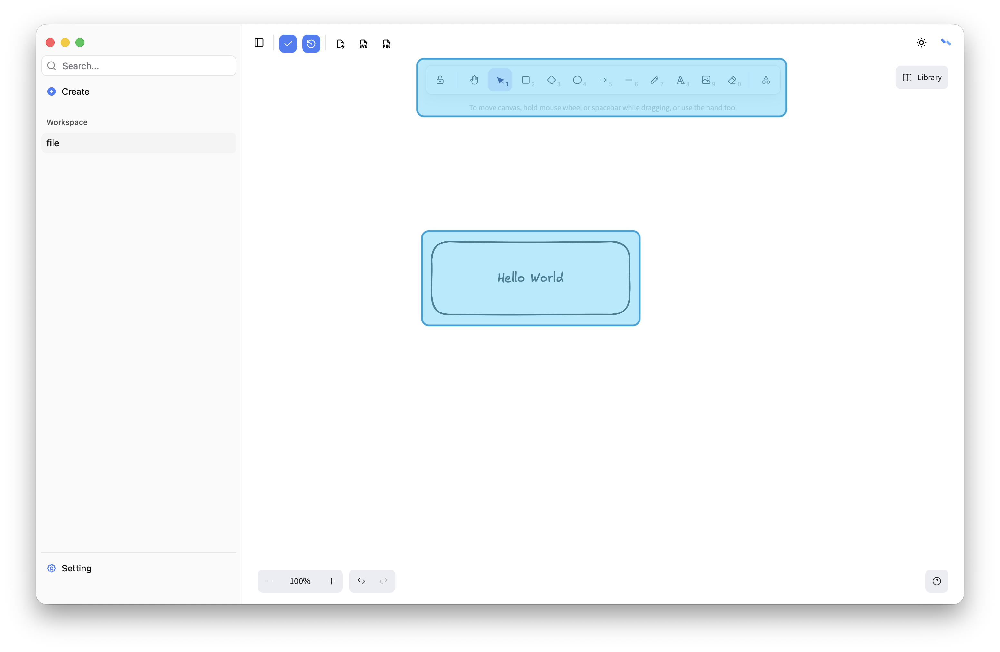
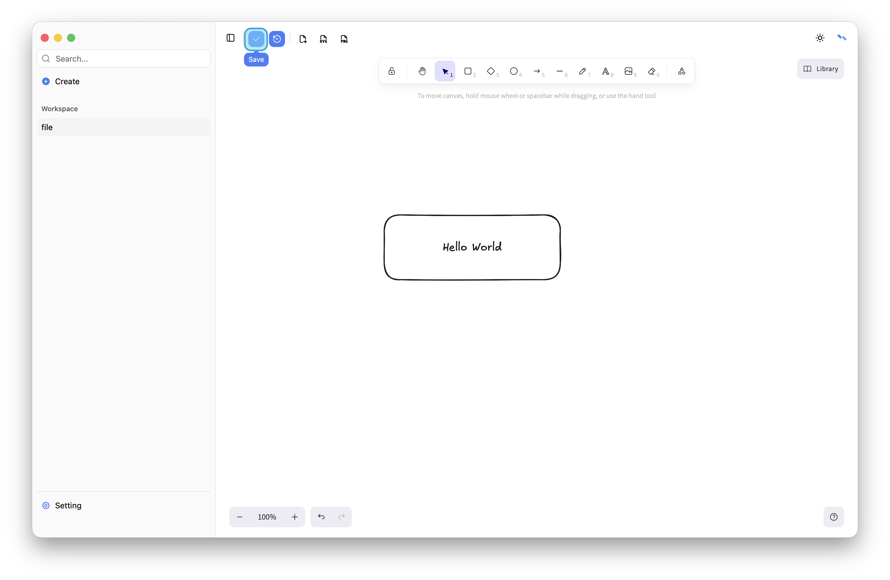

# First Local Whiteboard

Let's discover **Nexthena in less than 1 minute**.

## Getting Started

Download application . It supports Windows、Linux and MacOS.

### Install and Open

It's simple, just click click click.

### Create

Click left sidebar "Create" button, input you file name and choose source. you can choose local system path or embed
template.

### Edit

Add elements in right main area.

### Save

Click top menubar "Save" button for persistence.

**Congratulations! You have your first local whiteboard now.**
